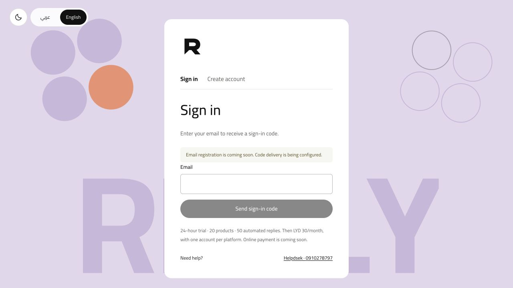
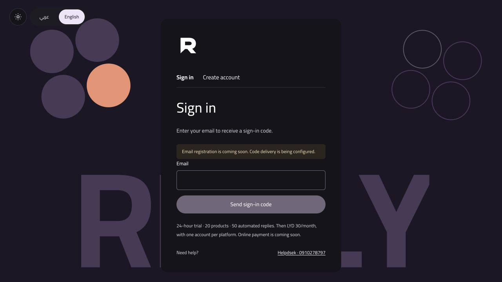
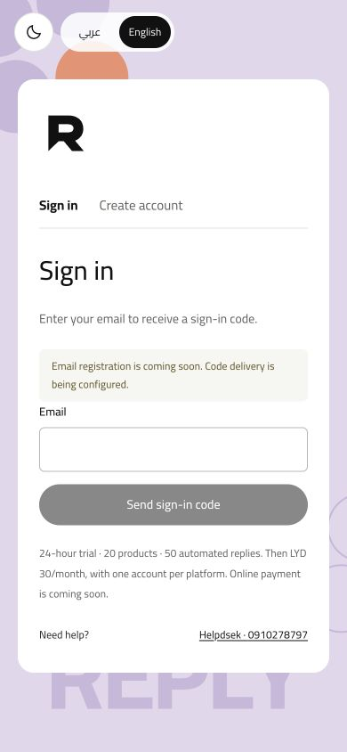

<div align="center">
  <picture>
    <source media="(prefers-color-scheme: dark)" srcset="assets/brand/logos/svg/reply-horizontal-white.svg">
    
  </picture>
  <h1>A clear answer starts with a product code.</h1>
  <p>An Arabic-first inventory and automated reply workspace for merchants in Libya.</p>
  <p>
    <a href="https://github.com/mohamedkbay/REPLY/actions/workflows/ci.yml"></a>
    
    <a href="LICENSE"></a>
    
  </p>
  <p><a href="#run-locally">Run locally</a> · <a href="docs/PRODUCT.md">Product</a> · <a href="docs/DESIGN-PHILOSOPHY.md">Design</a> · <a href="docs/ARCHITECTURE.md">Architecture</a> · <a href="deploy/README.md">Deploy</a></p>
</div>

## Reply in motion

[](docs/media/Reply-Showcase.mp4)

**[Watch the 32-second film](docs/media/Reply-Showcase.mp4)** · [Download the GIF](docs/media/Reply-Motion-Preview.gif) · [Showcase source and production notes](assets/showcase/README.md)

Actual local-demo footage: the organic theme wave, layered menu, Arabic/English transition, product photo reply and phone layout. The film is 1080p at 30 fps; the looping GIF previews theme and menu motion directly in this README. Silence is intentional. Inventory is synthetic and no live messages are sent.

<details>
<summary>Compare light and dark desktop screenshots</summary>

<table>
  <thead><tr><th>Light mode</th><th>Dark mode</th></tr></thead>
  <tbody><tr>
    <td width="50%"><a href="docs/media/reply-login-light-desktop.jpg"></a></td>
    <td width="50%"><a href="docs/media/reply-login-dark-desktop.jpg"></a></td>
  </tr></tbody>
</table>

The same workspace in two modes. Both preserve Cairo, the standalone R identity and clear form hierarchy. Click a preview to inspect it at full size.

</details>

## The idea

A customer sends “How much?” or a photo. Reply asks for the product code. When the customer sends a known code, Reply reads the shop's saved inventory and responds with the product name, current price and optional photo. If the product is paused, it apologizes that it is unavailable. If the code does not exist, it asks the customer to check it.

The merchant controls the answer by maintaining a small, understandable stockroom. Prices are retrieved from inventory; they are not generated by a language model. The current reply engine is deterministic, with product matching, keyword rules and editable business responses. There is no LLM dependency or visual product recognition in this implementation.

## What is in this repository

| Area | Included behavior |
| --- | --- |
| Inventory | Codes, names, prices, currency selection with LYD default, optional JPG/PNG images, availability, search, list/gallery views |
| Replies | Product-code answers, code requests for price/photo questions, unavailable/unknown-code responses, editable FAQ topics and keyword automations |
| Connections | Settings for Instagram, Messenger, WhatsApp, Telegram and a separate TikTok comment workflow; credentials and permissions are required |
| Customer service runtime | Email OTP, isolated SQLite workspaces, a 24-hour limited trial and one connected account per platform |
| Interface | Arabic RTL by default, English LTR, self-hosted Cairo, phone layouts, persistent light/dark themes and organic preference transitions |
| Identity | Editable logos, symbols, patterns, icon library, font files, app/social formats and motion assets |
| Engineering | TypeScript domain code, Node adapter, D1 migrations, tests, Docker/Caddy deployment, backup tooling and CI |

### Current release boundary

This is a **local-verified pilot implementation**, not an already launched service. The latest local verification passes 158 tests, TypeScript and Worker bundling. The Node service has been exercised directly. Docker configuration was validated; the image was not run during the original verification because the Docker daemon was stopped.

- Email authentication uses Resend. Without a configured sending domain/key, the UI explicitly disables code delivery. There is no fixed OTP or default customer password.
- The trial lasts 24 hours, with 20 products and 50 automated reply attempts. A paid entitlement removes Reply's product/reply caps; platform policies and infrastructure limits still apply.
- The planned price is **LYD 30/month**. Checkout, eZone integration, charging and customer-facing paid activation are **not implemented**. The interface says “coming soon.”
- Real social delivery requires official platform access, valid credentials, approved permissions and public HTTPS callbacks. The prepared local setup uses dry-run mode.
- TikTok replies are public text comments on selected owned videos. This is not general TikTok inbox automation or image replies in comments.

Read the [capability boundaries](docs/INTEGRATIONS.md) and [launch checklist](docs/ROADMAP.md) before exposing the service.

## Run locally

Use Node.js 24 or newer. The customer service is a separate runtime from the inherited Cloudflare prototype.

```bash
git clone https://github.com/mohamedkbay/REPLY.git
cd REPLY
npm ci
npm run build:saas
```

Create a private local configuration with fresh independent secrets. This command refuses to overwrite an existing `.saas.env`:

```bash
node --input-type=module <<'JS'
import { randomBytes } from 'node:crypto';
import { writeFileSync } from 'node:fs';
const secret = () => randomBytes(32).toString('hex');
writeFileSync('.saas.env', [
  'PUBLIC_ORIGIN=http://127.0.0.1:8791',
  `AUTH_SECRET=${secret()}`,
  `ACCOUNT_ENCRYPTION_KEY=${secret()}`,
  'DRY_RUN=true',
  'RESEND_API_KEY=',
  'EMAIL_FROM=',
  ''
].join('\n'), { flag: 'wx', mode: 0o600 });
JS
npm run start:saas
```

Open **http://127.0.0.1:8791/**. An anonymous visitor starts at **Sign in**, with **Create account** beside it. The interface can be inspected without configuring email. To actually register, configure `RESEND_API_KEY` and a verified `EMAIL_FROM`, restart the process and use a real email code. An authenticated visitor returns to their workspace or subscription screen as appropriate.

The service starts with no customer accounts. Data is written to `.reply-data/`, which is excluded from Git. See [Configuration](docs/CONFIGURATION.md) for every environment setting and the separate single-shop workflow.

## Design that supports the work

Reply has an expressive entrance and a practical working interior. The response-shaped **R** symbol appears at sign-in and in shared navigation. It is not repeated on every panel. The full wordmark remains available for brand and editorial use.

Cairo is served locally in four weights so Arabic does not depend on a remote font request. Dark mode uses white primary writing and pale secondary writing on distinct dark surfaces. The menu, inventory and settings remain readable on a phone. Theme and language changes share an 880ms organic wave; reduced-motion preferences receive an immediate switch.

### Light and dark on a phone

<table>
  <thead><tr><th>Light mode</th><th>Dark mode</th></tr></thead>
  <tbody><tr>
    <td width="50%" align="center"></td>
    <td width="50%" align="center"></td>
  </tr></tbody>
</table>

These matching captures show the current sign-in screen in English, with the same layout, content and compact symbol. Arabic remains the initial interface default. The earlier inventory capture below predates the compact top-symbol refinement and shows synthetic demonstration products.


[Watch the actual theme and language transition](docs/media/Reply-Theme-Language-Motion.mp4) · [Read the design philosophy](docs/DESIGN-PHILOSOPHY.md) · [Browse the editable identity assets](assets/brand/README.md)

## Architecture at a glance

```text
Browser / email OTP / workspace-specific platform callbacks
                         |
                  Node HTTP service
              server/app.mjs + auth.mjs
                  /                \
       control.sqlite         customer workspace
       accounts, sessions,    one SQLite file per customer
       trial reservations,    products, media, rules,
       public media routing   connections and event logs
                                      |
                          shared TypeScript Worker core
                                      |
                         official platform APIs / dry run
```

The Node runtime adapts the shared D1-style query interface to SQLite. A customer's session selects their workspace on the server. The application is deliberately a single-process, single-server pilot. PostgreSQL, a durable queue and object storage are future scaling work, not hidden services already provisioned.

The original single-shop Worker remains usable separately. `npm run dev` and `npm run deploy` target that prototype; **they do not launch the multi-customer service**. See the [archived Cloudflare guide](docs/LEGACY-CLOUDFLARE.md).

## Documentation

| Guide | What it explains |
| --- | --- |
| [Product and merchant journeys](docs/PRODUCT.md) | Who Reply serves, reply precedence, availability, trial and subscription rules |
| [Architecture](docs/ARCHITECTURE.md) | Runtime boundaries, storage, sessions, callbacks, media, quotas and source map |
| [Design philosophy](docs/DESIGN-PHILOSOPHY.md) | Identity, typography, color, responsive structure, motion and accessibility |
| [Integration behavior](docs/INTEGRATIONS.md) | Platform-specific replies, photos, official access and TikTok limitations |
| [Configuration](docs/CONFIGURATION.md) | Local environment, runtime choices, commands and troubleshooting |
| [Deployment and operations](deploy/README.md) | Docker, HTTPS, storage, backups, restore and pilot boundaries |
| [Identity assets](assets/brand/README.md) | Logo variants, patterns, icons, fonts, tokens and export usage |
| [Roadmap](docs/ROADMAP.md) | Implemented, deferred and pre-launch work |
| [Contributing](CONTRIBUTING.md) | Git conventions, validation and pull-request expectations |
| [Security](SECURITY.md) | Sensitive files, reporting and operational boundaries |

`DESIGN.md` and `.impeccable/design.json` record the application design system. `PRODUCT.md` is the compact product context. The asset-kit tokens are an identity baseline; runtime dark tokens live in `public/reply-preferences.css` and the design-system files.

## Verify

```bash
npm test                 # Domain, routing, product, image, integration and SaaS tests
npm run check            # TypeScript + Cloudflare Worker dry-run bundle
npm run test:runtime     # workerd / Web Crypto / D1 compatibility checks
npm run build:saas       # Bundle the shared core for the Node runtime
```

CI executes these checks on pushes to `main` and pull requests. Unit/integration tests use mocks and isolated temporary storage. They do not certify live platform permissions, email deliverability, payment settlement or production capacity.

## Credits and license

Reply builds on [Paul Millerd's manychat-lite-cloudflare](https://github.com/paulmil11/manychat-lite-cloudflare). The upstream Git history and MIT copyright notice are retained. Reply adds the merchant inventory workflow, multi-platform adapters, bilingual identity/interface and customer service pilot. See [NOTICE.md](NOTICE.md) for attribution and asset provenance. Reply is not affiliated with ManyChat, Meta or TikTok.

**Support:** Helpdsek · WhatsApp [0910278797](https://wa.me/218910278797).
